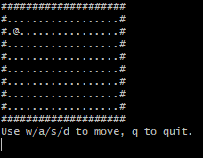

# Terminal Roguelike

A turn-based roguelike for the terminal, written in C++20!

## What it looks like


## Features
- Grid-based map with walls and floors
- Player movement with wall collision
- Single-key controls (no Enter needed)

## Controls
| Key | Action |
|-----|--------|
| W / A / S / D | Move up / left / down / right |
| Q | Quit |

## Requirements
Currently requires Windows with MSYS2 (UCRT64), g++, CMake 3.20 or newer, and Ninja. The input currently uses '<conio.h>', so it will only work on Windows.

## Building

```bash
git clone <your repo URL>
cd terminal-roguelike
cmake -S . -B build -G Ninja
cmake --build build
```

Catch2 is downloaded automatically during the first configure step (requires an internet connection).

## Running

```bash
./build/roguelike.exe
```

## Running the tests

```bash
./build/roguelike_tests.exe
```

## Project Structure

```
terminal-roguelike/
├── CMakeLists.txt        # Build configuration (library, game, tests)
├── include/              # Header files: the public interface of each component
│   ├── Position.h        # Grid coordinates, directions, and the step() helper
│   ├── Map.h             # Tile grid with bounds and walkability checks
│   ├── Player.h          # Player state
│   ├── Game.h            # Owns the map and player; enforces movement rules
│   ├── Input.h           # Translates key presses into game commands
│   ├── Renderer.h        # Draws the game as text to any output stream
│   └── Terminal.h        # Platform-specific single-key input
├── src/                  # Implementation files
│   ├── main.cpp          # Game loop: draw, read input, update
│   └── ...               # One .cpp per header above
└── tests/                # Catch2 unit tests, one file per component
```

### Design

The code is split into three layers:

- **Game logic** (`Position`, `Map`, `Player`, `Game`, `Input`, `Renderer`) is built as a
  static library, `roguelike_core`. It has no dependency on the terminal: the renderer
  writes to any `std::ostream`, and input is parsed from plain characters. This makes
  every part of it unit-testable.
- **Platform I/O** (`Terminal`) handles reading raw key presses. It is linked only into
  the game executable, so the tests never depend on a keyboard or a specific OS.
- **The game loop** (`main.cpp`) only connects the pieces. It contains no game rules.

Both the game (`roguelike`) and the test suite (`roguelike_tests`) link against
`roguelike_core`, so the tests run the same compiled code as the game.


## Roadmap
- Monsters and turn-based combat
- Procedurally generated maps
- A larger world made of connected areas, with transitions between them
- Field of view
- Graphical rendering with sprites: because the renderer is separate from
  the game logic, a graphical renderer could replace the text one